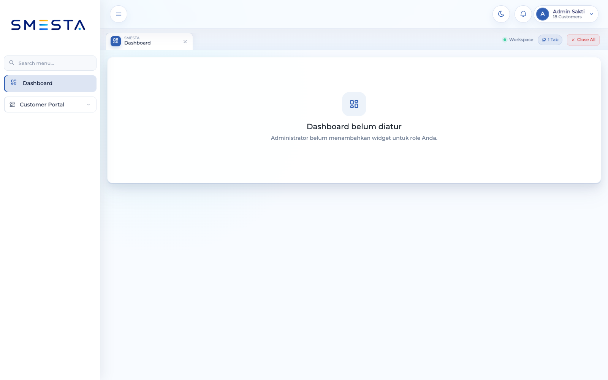
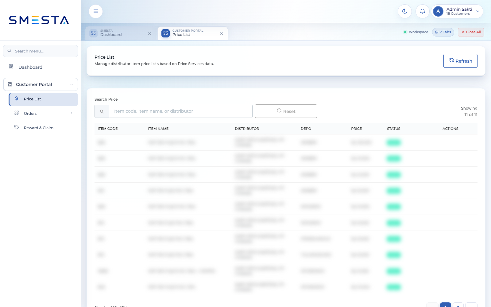
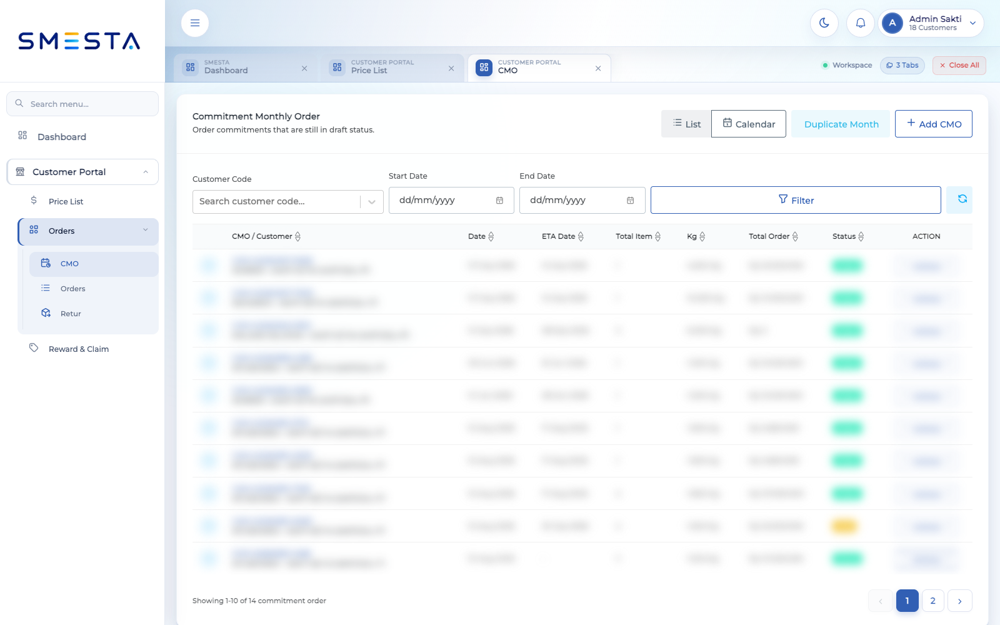
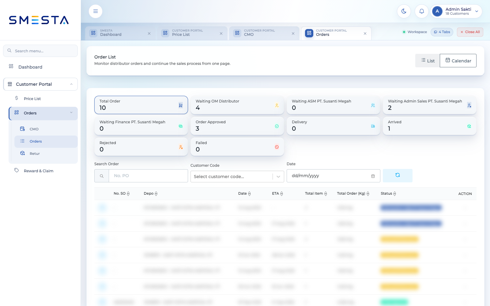
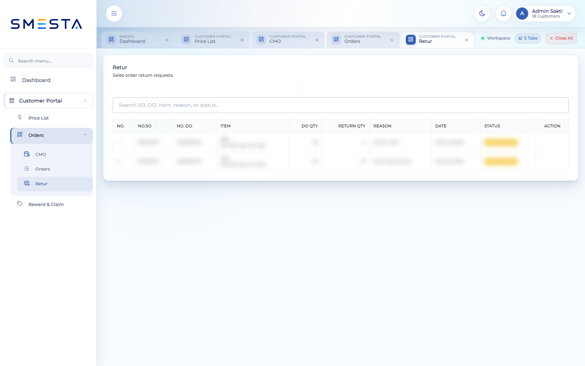
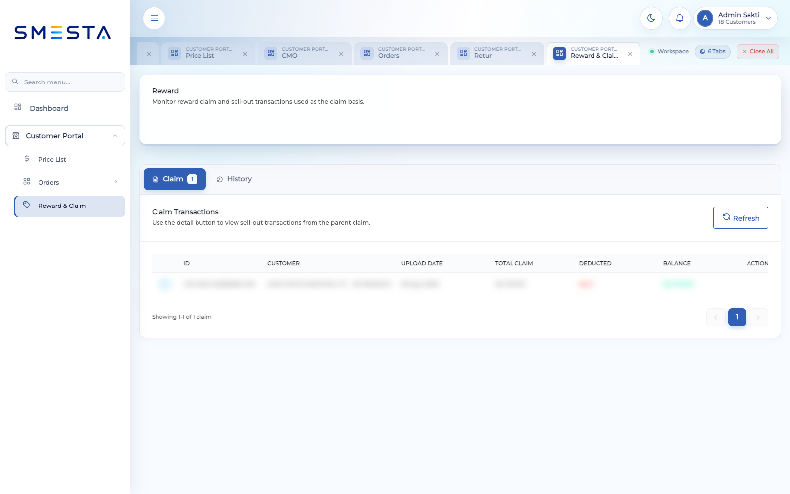

# Panduan Pengguna SMESTA — Admin Sakti

**Portal:** https://smesta-dev.susantimegah.com  
**Username:** `adminsakti`  
**Profil akun:** Admin Sakti — 18 Customers  
**Versi dokumen:** 1.0  
**Tanggal verifikasi:** 15 Oktober 2026

> Password tidak dicantumkan dalam dokumen. Gunakan password yang diberikan oleh administrator dan jangan membagikannya kepada pihak lain.

## 1. Hak akses akun

Panduan ini dibuat melalui pemeriksaan langsung terhadap menu yang tampil setelah login sebagai **Admin Sakti**. Akun ini hanya memiliki akses ke sistem **Customer Portal** dengan menu berikut:

| Menu | Akses yang tersedia |
|---|---|
| Dashboard | Membuka halaman dashboard; belum ada widget untuk role ini |
| Price List | Melihat, mencari, memuat ulang, dan membuka halaman daftar harga |
| CMO | Melihat daftar/kalender, memfilter, menambah, menduplikasi bulan, mengekspor, dan membuka aksi CMO |
| Orders | Melihat daftar/kalender order, status, customer, tanggal, dan rincian order sesuai aksi yang tersedia |
| Retur | Melihat dan mencari daftar retur serta statusnya |
| Reward & Claim | Melihat tab Claim dan History serta memuat ulang data |

### Menu yang tidak tersedia

Menu berikut tidak diberikan kepada akun ini dan tidak akan muncul pada sidebar:

- Sales Employees
- Promo Program
- Master Target
- Master Product
- Master Distributor
- Master Buying Price
- Pengaturan sistem dan pengguna
- Modul Corporate, Logistics, Production, dan Vendor Management

Jika salah satu menu tersebut dibutuhkan, mintalah administrator menambahkan permission pada akun. Jangan memakai akun milik pengguna lain.

## 2. Login

1. Buka `https://smesta-dev.susantimegah.com`.
2. Masukkan username `adminsakti`.
3. Masukkan password yang diberikan administrator.
4. Klik **Sign In**.
5. Setelah login berhasil, sistem membuka workspace **Customer Portal**.

Jika sistem memberi tahu bahwa akun sedang aktif pada sesi lain, pastikan tidak ada pekerjaan yang masih berjalan sebelum memilih untuk melanjutkan sesi baru.

## 3. Workspace dan navigasi

Setiap menu yang dibuka tampil sebagai tab pada bagian atas workspace. Jumlah tab aktif terlihat di kanan atas.

- Klik tab untuk berpindah halaman tanpa menutup halaman lain.
- Klik ikon **×** pada tab untuk menutup satu halaman.
- Klik **Close All** untuk menutup seluruh tab selain halaman utama.
- Gunakan **Search menu...** pada sidebar untuk mencari menu.
- Klik grup **Orders** untuk menampilkan CMO, Orders, dan Retur.

## 4. Dashboard

Untuk akun ini, halaman Dashboard menampilkan pesan **“Dashboard belum diatur”** karena administrator belum menambahkan widget untuk role Admin Sakti.

Kondisi ini bukan error. Gunakan sidebar untuk langsung membuka Price List, CMO, Orders, Retur, atau Reward & Claim.

## 5. Price List

Menu **Price List** digunakan untuk melihat harga item per distributor dan depo.

### Informasi yang tersedia

- Item Code
- Item Name
- Distributor
- Depo
- Price
- Status
- Actions, bila ada tindakan yang diizinkan

### Mencari harga

1. Buka **Customer Portal > Price List**.
2. Isi kolom **Item code, item name, or distributor**.
3. Daftar akan menyesuaikan dengan kata kunci.
4. Klik **Reset** untuk menghapus pencarian.
5. Klik **Refresh** untuk mengambil data harga terbaru.

Akun ini tidak menampilkan tombol **Add Price**, sehingga panduan ini tidak mencakup penambahan atau perubahan harga.

## 6. Commitment Monthly Order (CMO)

Menu **Orders > CMO** digunakan untuk memantau dan membuat Commitment Monthly Order.

### Tampilan dan filter

- **List** menampilkan CMO dalam tabel.
- **Calendar** menampilkan CMO berdasarkan tanggal.
- **Customer Code** membatasi data ke customer tertentu.
- **Start Date** dan **End Date** membatasi periode.
- **Filter** menerapkan pilihan filter.
- **Export CMO** mengunduh laporan CMO bila tindakan tersedia.

### Membuat CMO

1. Klik **Add CMO**.
2. Pilih customer code.
3. Lengkapi informasi order, tanggal, ETA, alamat, sales, dan catatan yang diminta.
4. Tambahkan item dan kuantitas.
5. Periksa harga, diskon, pajak, total berat, dan total order.
6. Simpan sebagai **Draft** jika data belum final.
7. Submit setelah seluruh data benar.

### Menduplikasi CMO bulanan

1. Klik **Duplicate Month**.
2. Pilih sumber bulan dan tujuan bulan sesuai dialog.
3. Periksa nomor PO, customer, tanggal, item, dan kuantitas hasil duplikasi.
4. Simpan atau submit sesuai kebutuhan.

### Aksi pada baris CMO

Gunakan tombol **Actions** pada baris untuk membuka tindakan yang diizinkan oleh status dan permission akun. Tindakan dapat berbeda antara CMO Draft dan Posted.

## 7. Orders

Menu **Orders > Orders** digunakan untuk memantau proses sales order.

### Ringkasan status

Bagian atas halaman menampilkan jumlah order berdasarkan status, antara lain:

- Waiting OM Distributor
- Waiting ASM PT. Susanti Megah
- Waiting Admin Sales PT. Susanti Megah
- Waiting Finance PT. Susanti Megah
- Order Approved
- Delivery
- Arrived
- Rejected
- Failed

Klik kartu status untuk memfilter daftar.

### Mencari order

1. Pilih **List** atau **Calendar**.
2. Masukkan nomor PO pada kolom pencarian bila diperlukan.
3. Pilih **Customer Code**.
4. Pilih tanggal.
5. Buka baris order atau tindakan yang tersedia untuk melihat detail.

Kolom daftar mencakup nomor SO, depo, tanggal, ETA, total item, total berat, status, dan action. Tombol pembuatan order baru tidak tampil pada akun ini; pembuatan order dilakukan melalui CMO sesuai akses yang tersedia.

## 8. Retur

Menu **Orders > Retur** menampilkan permintaan retur sales order.

### Informasi retur

- Nomor SO dan DO
- Item
- Kuantitas DO
- Kuantitas retur
- Alasan
- Tanggal
- Status
- Action, jika tersedia

Gunakan kolom pencarian untuk mencari berdasarkan SO, DO, item, alasan, atau status. Pada pemeriksaan akun ini, halaman berfungsi sebagai daftar monitoring dan tidak menampilkan tombol untuk membuat retur baru.

## 9. Reward & Claim

Menu **Reward & Claim** digunakan untuk memantau claim dan riwayat transaksi reward.

### Tab Claim

Tab ini menampilkan ID upload, customer, tanggal upload, total claim, nilai yang sudah dipotong, saldo, dan action. Klik **Refresh** untuk mengambil data terbaru.

### Tab History

Klik **History** untuk melihat riwayat reward dan claim. Gunakan filter customer bila ditampilkan.

Akun ini tidak menampilkan tombol untuk menambah claim atau withdrawal. Hubungi administrator jika akun seharusnya memiliki tindakan tersebut.

## 10. Arti status utama

| Status | Arti |
|---|---|
| Draft | Data tersimpan dan belum diproses ke tahap berikutnya |
| Posted | CMO sudah diposting |
| Waiting OM Distributor | Menunggu tindakan atau persetujuan OM distributor |
| Waiting ASM | Menunggu persetujuan ASM |
| Waiting Admin Sales | Menunggu tindakan Admin Sales |
| Waiting Finance | Menunggu pemeriksaan atau persetujuan Finance |
| Order Approved | Order telah disetujui |
| Delivery | Barang sedang dikirim |
| Arrived | Barang telah sampai |
| Rejected | Pengajuan ditolak |
| Failed | Proses gagal dan perlu diperiksa |
| Active | Data masih berlaku dan dapat digunakan |

## 11. Batasan permission akun

Jangan berasumsi bahwa tombol yang dijelaskan pada panduan umum tersedia pada akun ini. Berdasarkan pemeriksaan langsung:

- Price List tidak menyediakan Add/Edit/Delete Price.
- Orders tidak menyediakan tombol pembuatan order baru.
- Retur tidak menyediakan tombol pembuatan retur baru.
- Reward & Claim tidak menyediakan Add Claim atau Withdrawal.
- Dashboard belum memiliki widget.
- Fitur yang memerlukan permission tambahan akan disembunyikan oleh sistem.

## 12. Troubleshooting

### Menu tidak terlihat

Pastikan menu termasuk dalam daftar akses pada bagian 1. Jika tidak termasuk, hubungi administrator untuk permintaan permission.

### Data tidak ditemukan

- Hapus filter dengan **Reset**.
- Periksa customer code dan periode.
- Klik **Refresh**.
- Pastikan akun masih terhubung ke customer yang benar.

### Sesi berakhir

Login kembali melalui halaman utama. Jangan membagikan password dan hindari penggunaan akun yang sama secara bersamaan pada banyak perangkat.

### Melaporkan masalah

Sertakan username, nama menu, waktu kejadian, langkah sebelum masalah, pesan error, dan screenshot yang tidak memperlihatkan informasi rahasia. Jangan menyertakan password atau token.

> Screenshot dalam dokumen ini diambil dari akun yang sama, tetapi nilai pada tabel disamarkan untuk melindungi data operasional.
