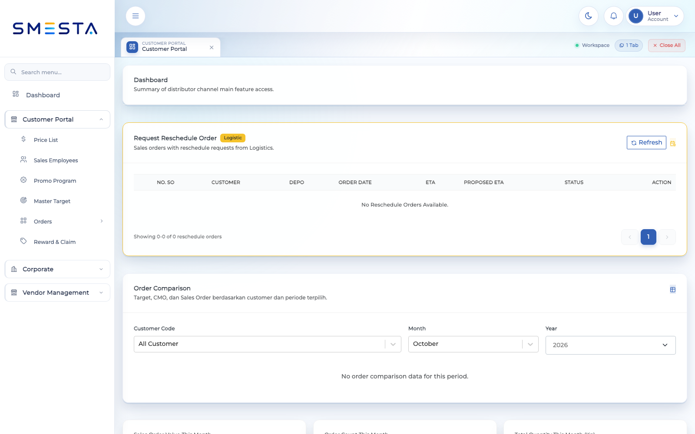
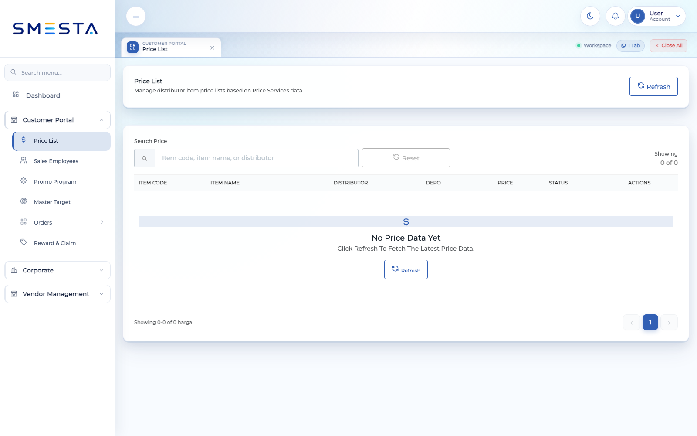
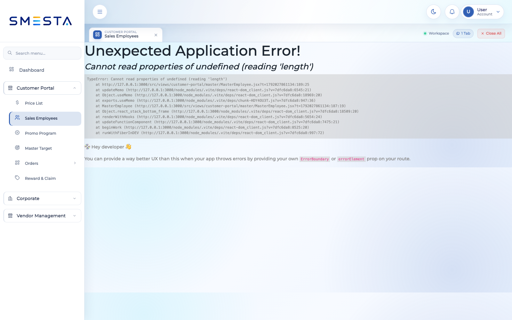
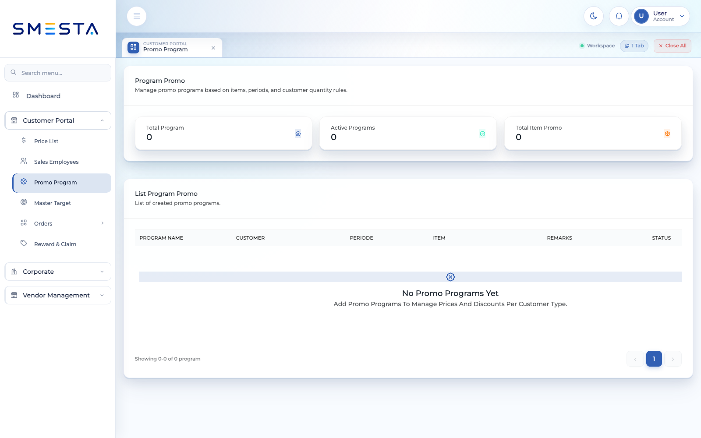
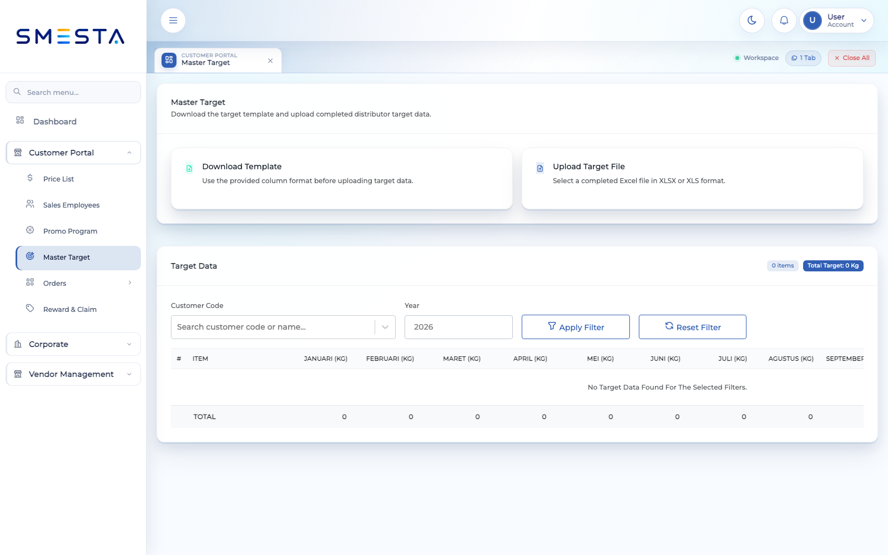
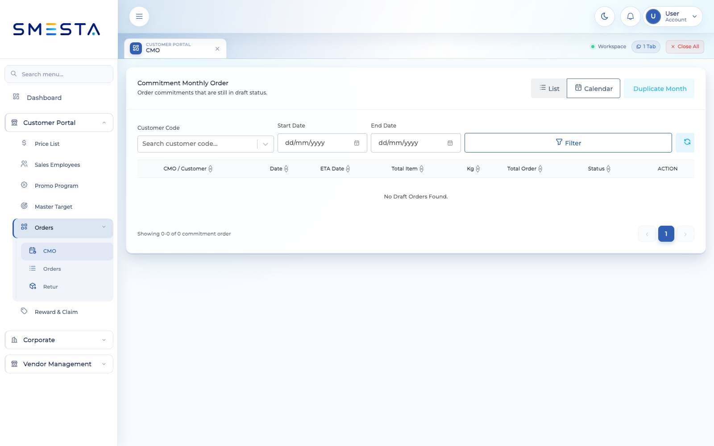
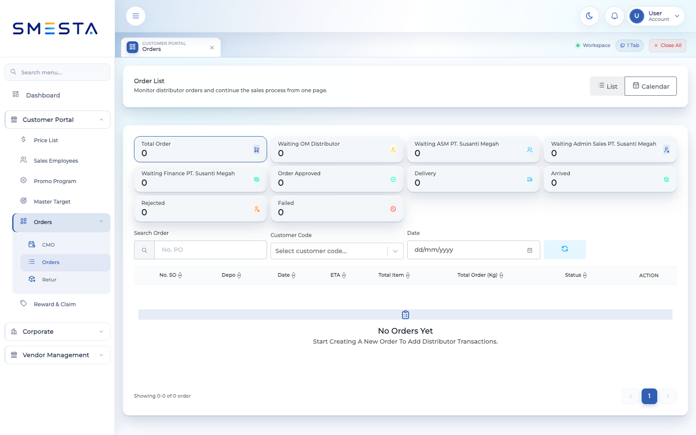
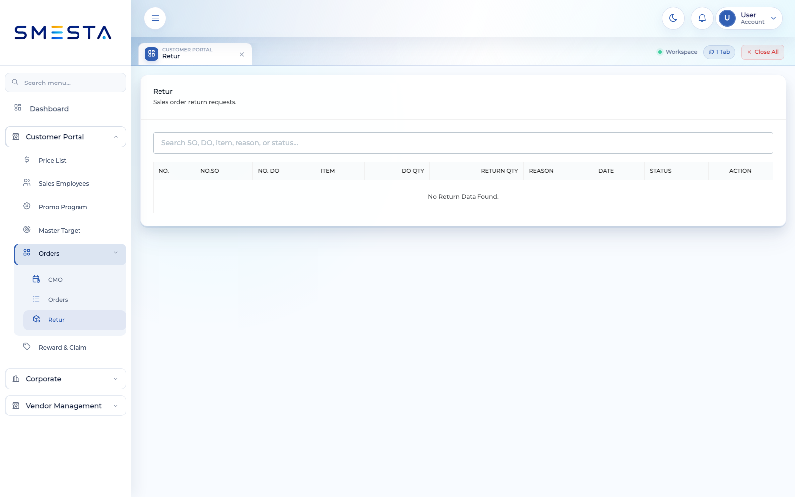
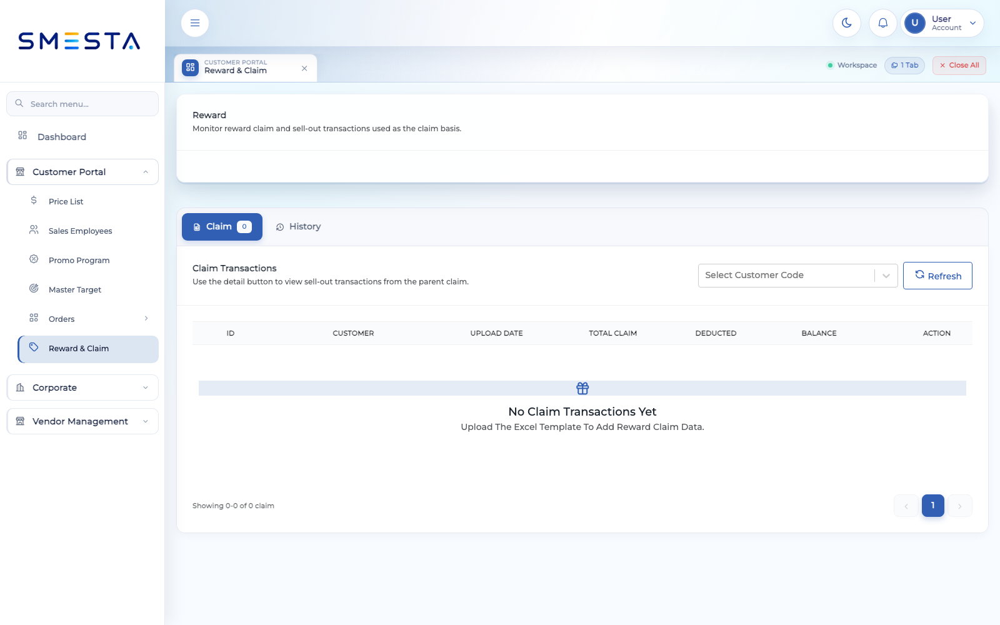

# Panduan Pengguna Distributor Channel

**Target pengguna:** Distributor  
**Aplikasi:** SMESTA Distributor Channel  
**Versi dokumen:** 1.0  
**Tanggal:** 15 Oktober 2026

## 1. Tentang panduan ini

Panduan ini membantu pengguna distributor memakai Distributor Channel untuk memantau aktivitas penjualan, mengelola data pendukung, membuat CMO dan pesanan, mengajukan retur, serta mengelola reward dan claim.

Tampilan menu dan tombol pada setiap akun dapat berbeda. Sistem hanya menampilkan fungsi yang diberikan kepada akun tersebut oleh administrator.

## 2. Persiapan

Sebelum menggunakan sistem, pastikan:

- Anda memiliki username dan password yang aktif.
- Akun sudah terhubung ke kode distributor/customer yang benar.
- Perangkat memiliki koneksi internet stabil.
- Browser yang digunakan adalah versi terbaru, misalnya Google Chrome atau Microsoft Edge.
- File pendukung sudah disiapkan bila akan mengunggah target, claim, atau bukti retur.

## 3. Masuk ke sistem

1. Buka alamat Distributor Channel yang diberikan administrator.
2. Tunggu hingga halaman login selesai dimuat.
3. Masukkan **Username**.
4. Masukkan **Password**. Gunakan ikon mata untuk menampilkan atau menyembunyikan password.
5. Selesaikan verifikasi keamanan apabila ditampilkan.
6. Klik **Login**.

Jika akun masih aktif pada perangkat lain, sistem dapat meminta konfirmasi untuk melanjutkan login. Ikuti konfirmasi yang muncul jika Anda memang ingin menggunakan sesi baru.

### Kendala login

- Periksa kembali penulisan username dan password.
- Pastikan tombol Caps Lock tidak aktif.
- Muat ulang halaman bila verifikasi keamanan tidak muncul.
- Jika muncul informasi sesi kedaluwarsa, login kembali.
- Hubungi administrator jika akun terkunci atau menu distributor tidak tersedia.

## 4. Mengenal halaman utama

Setelah login, pengguna distributor diarahkan ke **Dashboard Customer Portal**. Halaman ini merangkum informasi penting, seperti performa order, nilai order, daftar order terkini, estimasi kedatangan, permintaan perubahan jadwal, dan aktivitas retur.

Gunakan filter **Customer Code**, **Month**, dan **Year** untuk menampilkan data sesuai distributor dan periode yang dibutuhkan. Klik **View All** atau tombol tindakan pada kartu untuk membuka informasi lebih lengkap.

Menu utama terbagi menjadi:

| Kelompok | Menu | Fungsi |
|---|---|---|
| Master Data | Price List | Melihat dan, bila diizinkan, mengelola harga produk distributor |
| Master Data | Sales Employees | Melihat dan mengelola sales yang terhubung ke distributor |
| Master Data | Promo Program | Melihat dan mengelola program promo |
| Master Data | Master Target | Mengunduh template, mengunggah, dan memantau target |
| Orders | CMO | Mengelola Commitment Monthly Order |
| Orders | Orders | Membuat dan memantau sales order |
| Orders | Retur | Melihat detail dan status retur |
| Reward & Claim | Reward & Claim | Mengelola claim, riwayat reward, dan withdrawal |

## 5. Price List

Menu **Master Data > Price List** digunakan untuk melihat harga item yang berlaku bagi distributor.

### Mencari harga

1. Buka **Price List**.
2. Masukkan kode item, nama item, atau nama distributor pada kolom pencarian.
3. Pilih status data bila filter status tersedia.
4. Klik tombol pencarian atau pemuatan data.
5. Klik tombol tindakan pada baris untuk melihat detail.
6. Klik **Reset** untuk menghapus filter.

### Menambah atau mengubah harga

Jika akun memiliki izin:

1. Klik **Add Price**, atau buka tindakan baris lalu pilih **Edit**.
2. Pilih item.
3. Pilih satu atau beberapa distributor. Saat mengubah data, pilihan distributor dapat dibatasi.
4. Periksa satuan pada kolom **UOM**.
5. Isi harga dan pilih status aktif/nonaktif.
6. Simpan perubahan.

Gunakan **Delete** hanya setelah memastikan harga tersebut tidak lagi dibutuhkan.

## 6. Sales Employees

Menu **Master Data > Sales Employees** menampilkan sales yang ditugaskan ke distributor.

### Melihat data sales

1. Buka **Sales Employees**.
2. Cari berdasarkan kode atau nama sales.
3. Gunakan filter customer bila tersedia.
4. Klik tindakan pada baris untuk melihat detail.

### Menambah atau mengubah sales

1. Klik **Add Sales**, atau pilih **Edit** pada data yang sudah ada.
2. Pilih sales.
3. Pilih distributor/customer yang ditangani.
4. Periksa kode sales dan informasi customer yang terisi otomatis.
5. Simpan.

## 7. Promo Program

Menu **Master Data > Promo Program** digunakan untuk mengelola program promo yang dapat diterapkan pada transaksi.

### Membuat program promo

1. Buka **Promo Program**.
2. Klik **Add Program Promo**.
3. Isi nama program.
4. Pilih item promo dan customer sasaran.
5. Tentukan periode berlaku dan status program.
6. Tambahkan deskripsi bila diperlukan.
7. Isi detail aturan promo pada tabel, termasuk batas kuantitas atau nilai yang diminta sistem.
8. Klik tombol tambah baris bila aturan lebih dari satu.
9. Simpan program.

Gunakan menu tindakan untuk melihat detail, mengubah, menduplikasi, atau menghapus program sesuai izin akun.

## 8. Master Target

Menu **Master Data > Master Target** digunakan untuk mengelola target distributor melalui file Excel.

### Mengunduh template target

1. Buka **Master Target**.
2. Klik **Download Template**.
3. Pilih tahun target.
4. Klik **Download File**.
5. Isi file tanpa mengubah nama atau urutan kolom template.

### Mengunggah target

1. Klik **Upload Excel**.
2. Pilih file berformat `.xlsx` atau `.xls`.
3. Tunggu proses pembacaan dan validasi selesai.
4. Periksa pesan berhasil atau rincian kesalahan yang muncul.
5. Gunakan pencarian customer untuk memastikan target sudah masuk.

## 9. CMO

Menu **Orders > CMO** digunakan untuk merencanakan Commitment Monthly Order.

### Membuat CMO

1. Buka **CMO**.
2. Klik tombol untuk membuat CMO baru.
3. Pilih customer/distributor dan lengkapi informasi dokumen.
4. Tambahkan produk dan kuantitas yang direncanakan.
5. Periksa harga, diskon, promo, pajak, total berat, dan total nilai.
6. Klik **Save Draft** jika data belum final.
7. Kirim CMO ketika seluruh data sudah benar.

### Mengelola CMO

- Gunakan kartu status dan filter untuk mempersempit daftar.
- Gunakan tampilan kalender untuk melihat CMO berdasarkan tanggal.
- Buka detail untuk memeriksa item dan status persetujuan.
- Gunakan **Duplicate** untuk menyalin CMO bulanan, lalu isi nomor PO dan komentar baru.
- Hapus hanya CMO yang masih memenuhi ketentuan penghapusan.
- Unduh laporan Excel bila tombol laporan tersedia.

## 10. Orders

Menu **Orders > Orders** digunakan untuk membuat dan memantau sales order.

### Membuat order

1. Buka **Orders**.
2. Klik tombol untuk membuat order baru.
3. Lengkapi bagian **Information Order**:
   - customer;
   - nomor PO;
   - sales;
   - kontak customer;
   - tanggal dokumen dan estimasi kedatangan;
   - series sales order;
   - alamat penagihan dan pengiriman;
   - catatan order.
4. Unggah dokumen pendukung jika diperlukan. Ukuran maksimum setiap dokumen adalah **1 MB**.
5. Pada **Product Details**, pilih produk lalu isi kuantitas, gudang atau aturan distribusi, pajak, dan catatan baris.
6. Tambahkan diskon atau promo melalui **Set Order Discount** bila berlaku.
7. Periksa **Order Summary**, termasuk subtotal, diskon, reward yang digunakan, pajak, total berat, dan grand total.
8. Pilih salah satu tindakan:
   - **Save Draft** untuk menyimpan tanpa mengirim;
   - **Save & Close** bila tersedia;
   - **Submit** untuk mengirim order ke proses berikutnya.
9. Setujui dialog konfirmasi.

### Memantau order

1. Gunakan kartu status untuk memilih order Draft, Waiting Approval, Approved, Delivery, Arrived, Rejected, atau Failed.
2. Cari berdasarkan nomor PO atau customer code.
3. Gunakan tampilan tabel atau kalender.
4. Buka **Order Detail** untuk memeriksa informasi dan item.
5. Unduh PDF atau lampiran bila tersedia.
6. Gunakan tindakan pembatalan hanya jika order masih dapat dibatalkan.

Status dapat melewati beberapa tahap persetujuan, misalnya **Waiting OM**, **Waiting ASM**, atau **Waiting Admin Sales**, tergantung alur perusahaan.

## 11. Retur

Menu **Orders > Retur** menampilkan permintaan pengembalian barang dan status prosesnya.

### Mencari dan melihat retur

1. Buka **Retur**.
2. Cari berdasarkan nomor SO, DO, item, alasan, atau status.
3. Buka detail retur untuk melihat barang, kuantitas, alasan, status, dan lampiran.
4. Klik lampiran untuk melihat preview bila formatnya didukung.

### Mengajukan retur dari dashboard

Jika tindakan retur tersedia pada order:

1. Buka order yang akan diretur.
2. Pilih tindakan retur.
3. Tentukan item dan kuantitas retur.
4. Isi alasan secara jelas.
5. Tambahkan bukti pendukung.
6. Periksa kembali lalu kirim.

Maksimum lampiran retur adalah **5 file** dengan ukuran maksimum **1 MB per file**. Gambar berukuran besar dapat dikompresi otomatis oleh sistem.

## 12. Reward & Claim

Menu **Reward & Claim** menyediakan tab claim dan riwayat reward. Fitur yang terlihat mengikuti izin akun dan distributor yang dipilih.

### Mengajukan claim

1. Buka **Reward & Claim**.
2. Pilih tab **Claim**.
3. Pilih customer code jika akun menangani lebih dari satu distributor.
4. Klik **Add Reward Claim**.
5. Isi nominal dan deskripsi claim.
6. Unggah data menggunakan template bila alur claim meminta file.
7. Kirim dan tunggu validasi.
8. Buka detail claim untuk melihat hasil pemrosesan dan item yang valid/tidak valid.

### Menggunakan template reward

1. Klik tombol unduh template.
2. Isi data pada template tanpa mengubah struktur kolom.
3. Unggah file yang sudah dilengkapi.
4. Tunggu pemrosesan selesai.
5. Periksa hasil upload dan perbaiki baris yang gagal.

### Mengajukan withdrawal

1. Pastikan hanya satu customer/distributor yang dipilih.
2. Klik **Add Reward Withdrawal**.
3. Masukkan nominal penarikan.
4. Pilih sumber claim bila diminta.
5. Isi deskripsi.
6. Periksa saldo yang tersedia.
7. Kirim permintaan dan pantau status pada riwayat.

Jangan mengajukan nominal melebihi saldo reward yang tersedia.

## 13. Arti status umum

| Status | Arti |
|---|---|
| Draft | Data tersimpan dan belum dikirim |
| Waiting Approval | Menunggu proses persetujuan |
| Waiting OM / ASM / Admin Sales | Menunggu persetujuan dari peran terkait |
| Approved / Order Approved | Data telah disetujui |
| Delivery | Barang dalam proses pengiriman |
| Arrived | Barang telah sampai |
| Rejected | Pengajuan ditolak; periksa catatan penolakan |
| Failed | Proses gagal; periksa pesan sistem atau hubungi administrator |
| Active | Data dapat digunakan |
| Inactive | Data tidak digunakan dalam transaksi baru |

## 14. Praktik yang disarankan

- Periksa customer code sebelum membuat transaksi.
- Pastikan nomor PO tidak salah atau duplikat.
- Simpan sebagai draft jika data belum lengkap.
- Verifikasi alamat pengiriman, item, kuantitas, harga, diskon, pajak, dan total sebelum submit.
- Gunakan catatan yang singkat dan jelas.
- Jangan menutup browser saat file sedang diunggah atau data sedang diproses.
- Hindari membuka akun yang sama pada banyak perangkat secara bersamaan.
- Logout setelah selesai, terutama pada komputer bersama.

## 15. Troubleshooting

### Menu atau tombol tidak muncul

Hak akses akun kemungkinan tidak mencakup fungsi tersebut. Hubungi administrator dan sampaikan nama akun, menu, serta tindakan yang dibutuhkan.

### Data distributor tidak sesuai

Periksa customer code yang aktif. Jika kode yang seharusnya tidak tersedia, minta administrator memeriksa assignment akun.

### File gagal diunggah

- Pastikan format file sesuai.
- Pastikan struktur template tidak diubah.
- Pastikan ukuran lampiran tidak melebihi batas.
- Tutup file Excel sebelum mengunggahnya kembali.
- Baca rincian baris gagal pada hasil validasi.

### Data tidak muncul

- Periksa filter tanggal, customer, dan status.
- Klik **Reset** untuk menghapus filter.
- Pastikan koneksi internet aktif.
- Muat ulang halaman dan login kembali jika sesi kedaluwarsa.

### Sistem tidak dapat terhubung

Tunggu beberapa saat dan gunakan tombol coba lagi jika ditampilkan. Bila masalah berlanjut, catat waktu kejadian dan pesan error untuk dilaporkan kepada administrator.

## 16. Informasi yang perlu disertakan saat meminta bantuan

Sertakan informasi berikut agar masalah lebih cepat ditangani:

- username tanpa menyertakan password;
- customer/distributor code;
- nama menu;
- langkah yang dilakukan sebelum masalah terjadi;
- pesan error;
- tanggal dan waktu kejadian;
- screenshot yang tidak menampilkan informasi rahasia.

> Jangan pernah mengirimkan password, token, atau informasi login kepada siapa pun.
